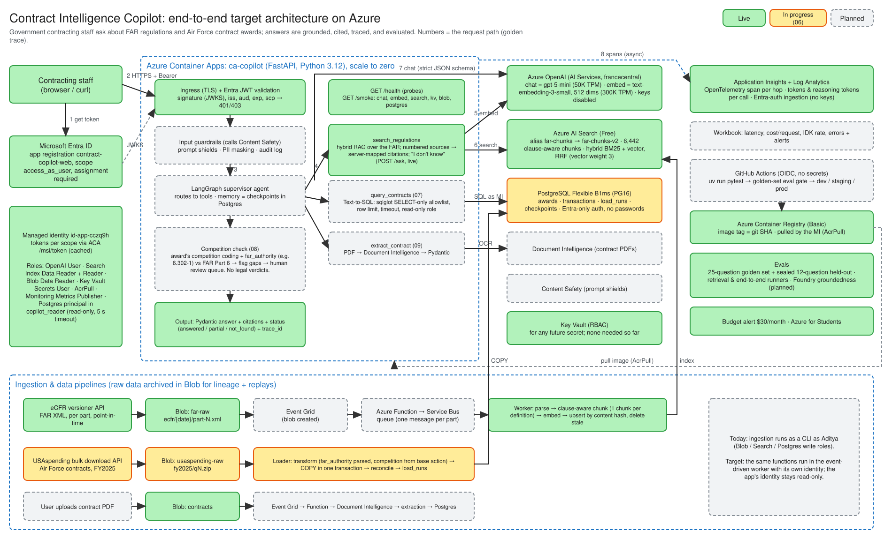

# Contract Intelligence Copilot

An AI assistant for government contracting staff: it answers questions about the **Federal Acquisition
Regulation (FAR)** with clause-level citations, says *"I don't know"* when the regulation doesn't cover a
question, and (in progress) analyzes **Air Force contract award data** from USAspending.gov. Built end to end
on Azure with managed identities, no API keys, OpenTelemetry tracing, and a measured evaluation loop.

> **Portfolio project.** It rebuilds patterns from my work (USC Hacking for Defense with Air Force users; a
> unified data layer at EcoPost) on Azure, to show the Azure version end to end. Public data only.



Green = live, amber = in progress, grey = planned. Editable source:
[`docs/architecture-end-to-end.excalidraw`](docs/architecture-end-to-end.excalidraw) (open at excalidraw.com).

## What works today
| Capability | Details |
|---|---|
| `POST /ask` (live, Entra sign-in) | Hybrid search (BM25 + vectors, RRF) over 6,442 clause-aware FAR chunks → gpt-5-mini with a strict JSON schema. The model cites **source numbers**; the server maps them to citations, so citations can't be invented. Validate → retry once → "I don't know". |
| FAR ingestion | eCFR XML per part → sections → chunks that never cross a section, split only at top-level paragraphs, one chunk per definition → embeddings (512 dims) → Azure AI Search. Incremental by content hash; raw XML archived in Blob. |
| Evaluation | 25-question golden set + a 12-question held-out set sealed before tuning. Retrieval-only and end-to-end runners. |
| Observability | Every hop is an App Insights span (auth, token fetches, embed, search, chat with token counts, validation), exported with an Entra token (key-based ingestion disabled). |
| Security | `DefaultAzureCredential` everywhere: managed identity in Azure, `az login` locally. Keys disabled on AI Services, Storage, App Insights; Postgres is Entra-only. App identity is read-only on all data. JWT validation in FastAPI (signature, issuer, audience, expiry, scope). |
| Award data (in progress) | USAspending bulk download → Postgres (`awards`, `transactions`), with the FAR authority parsed from the competition fields (e.g. `6.302-1`) as the join key to the regulations. |

## Measured results (not estimates)
Retrieval tuning ([design 05](docs/design/05-retrieval-tuning.md)), judged on the **held-out** set with the
"after" configuration committed before the held-out set was opened:

| Held-out (10 answerable + 2 unanswerable) | Before | After |
|---|---|---|
| Expected section retrieved (hit@8) | 7/10 | 9/10 |
| Expected section cited | 7/10 | 9/10 |
| "I don't know" on answerable questions | 1/10 | 0/10 |
| Correct "I don't know" on unanswerable | 2/2 | 2/2 |

Small samples: read these as directional. The losing experiments are reported too.

## How it was built
Every feature follows the same loop: **design doc first** → build to the design → trace the real HTTP
calls → break it on purpose → write down what was wrong.

| # | Design | |
|---|---|---|
| 00 | [Infra](docs/design/00-infra.md) | Each resource, the ARM call that created it, who can access it |
| 01 | [Skeleton](docs/design/01-skeleton.md) | `/health`, `/smoke`, one credential, token caching |
| 02 | [Deploy](docs/design/02-deploy.md) | Container Apps, ACR pull by managed identity, Entra JWT validation |
| 03 | [FAR ingestion](docs/design/03-far-ingestion.md) | Clause-aware chunking, Free-tier sizing gate |
| 04 | [RAG endpoint](docs/design/04-rag-endpoint.md) | Citations, "I don't know", tracing, baseline eval |
| 05 | [Retrieval tuning](docs/design/05-retrieval-tuning.md) | Dev vs sealed held-out, ablations, alias cutover |
| 06 | [Award data](docs/design/06-awards-postgres.md) | USAspending → Postgres, Entra-only DB auth |

Real failures and their root causes: [`docs/debugging-log.md`](docs/debugging-log.md). Decisions and status:
[`docs/status.md`](docs/status.md).

## Run it locally
Prerequisites: Python 3.12, [uv](https://docs.astral.sh/uv/), Azure CLI, access to the Azure resources (or
your own, created with `infra/setup.sh`).
```bash
uv sync
cp .env.example .env        # fill in endpoints; no keys needed
az login
uv run pytest
uv run uvicorn app.main:app --reload
```
Infrastructure is reproducible from [`infra/setup.sh`](infra/setup.sh) (one numbered step at a time,
`DEBUG=1` logs every ARM call), deploys from [`infra/deploy.sh`](infra/deploy.sh) (image tag = git SHA).

## Stack
Python 3.12 · FastAPI · Pydantic v2 · Azure OpenAI (gpt-5-mini, text-embedding-3-small) · Azure AI Search ·
Azure Container Apps · Azure Database for PostgreSQL · Blob Storage · Key Vault · Application Insights ·
OpenTelemetry · Entra ID. Budget: ~$30/month (Azure for Students).
